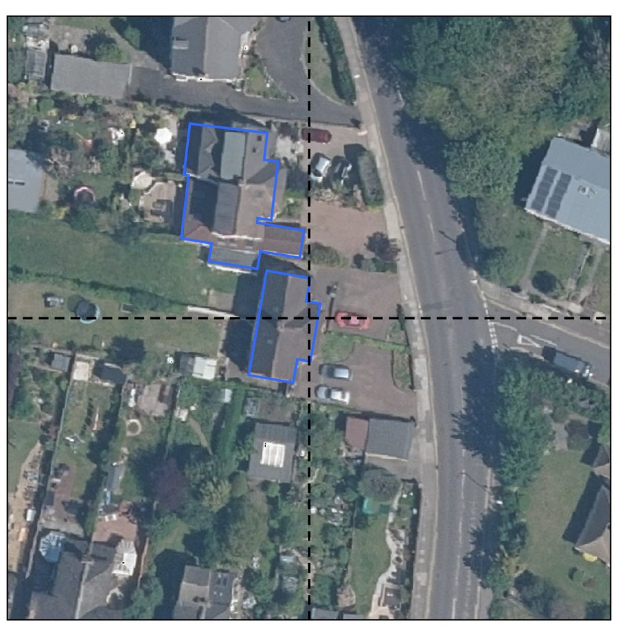
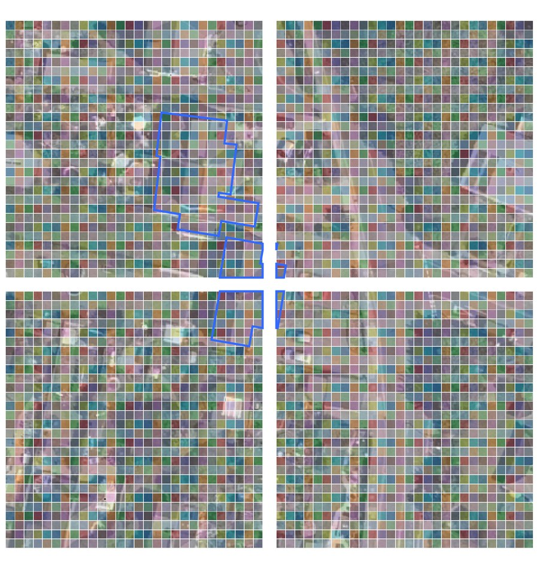
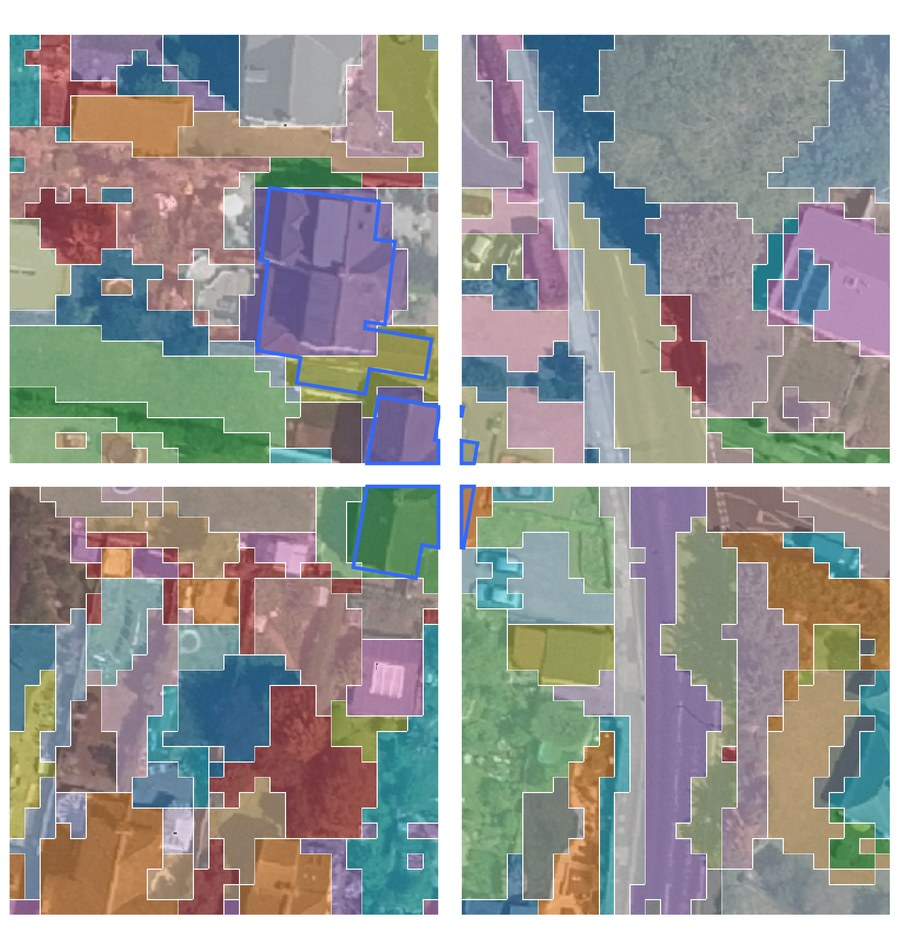
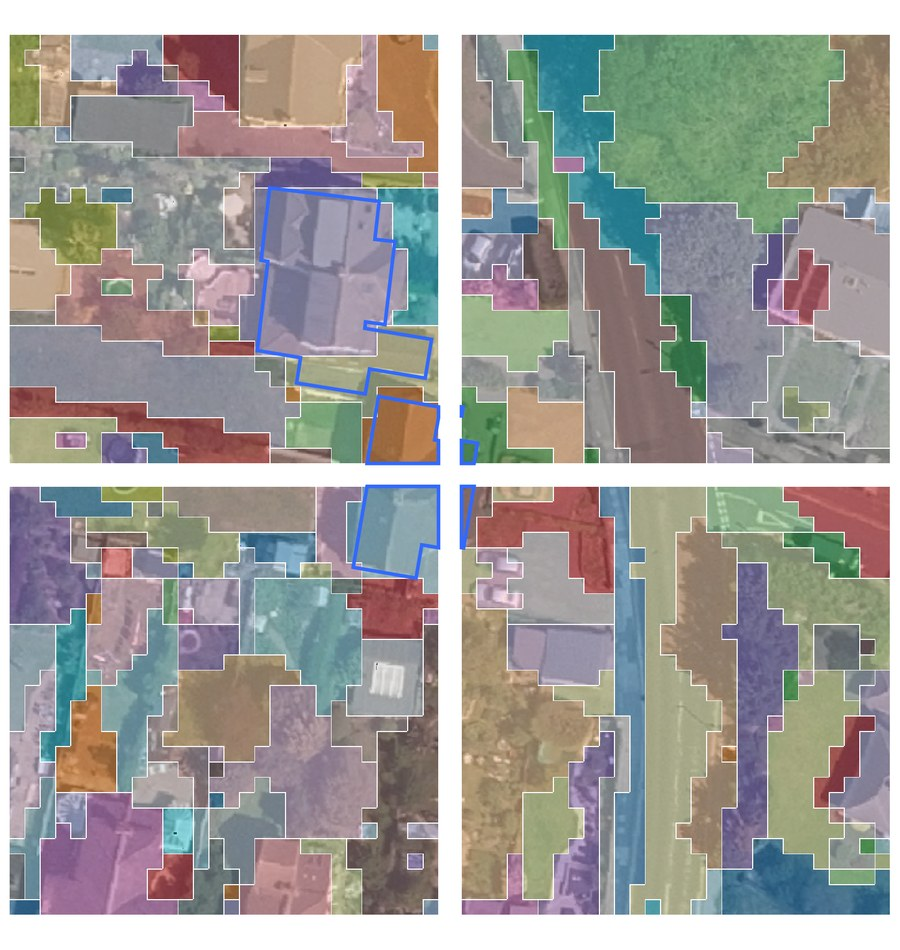
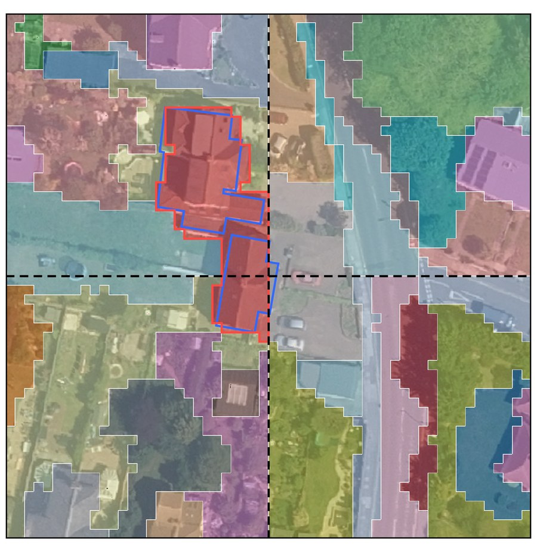
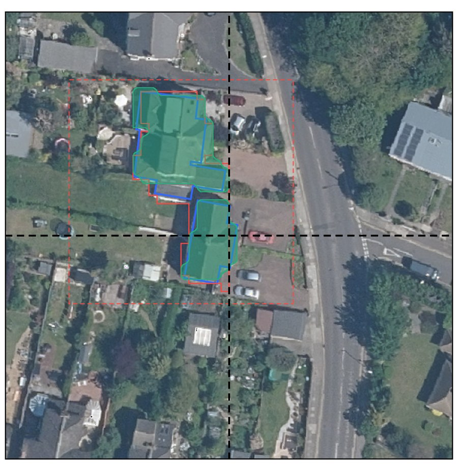
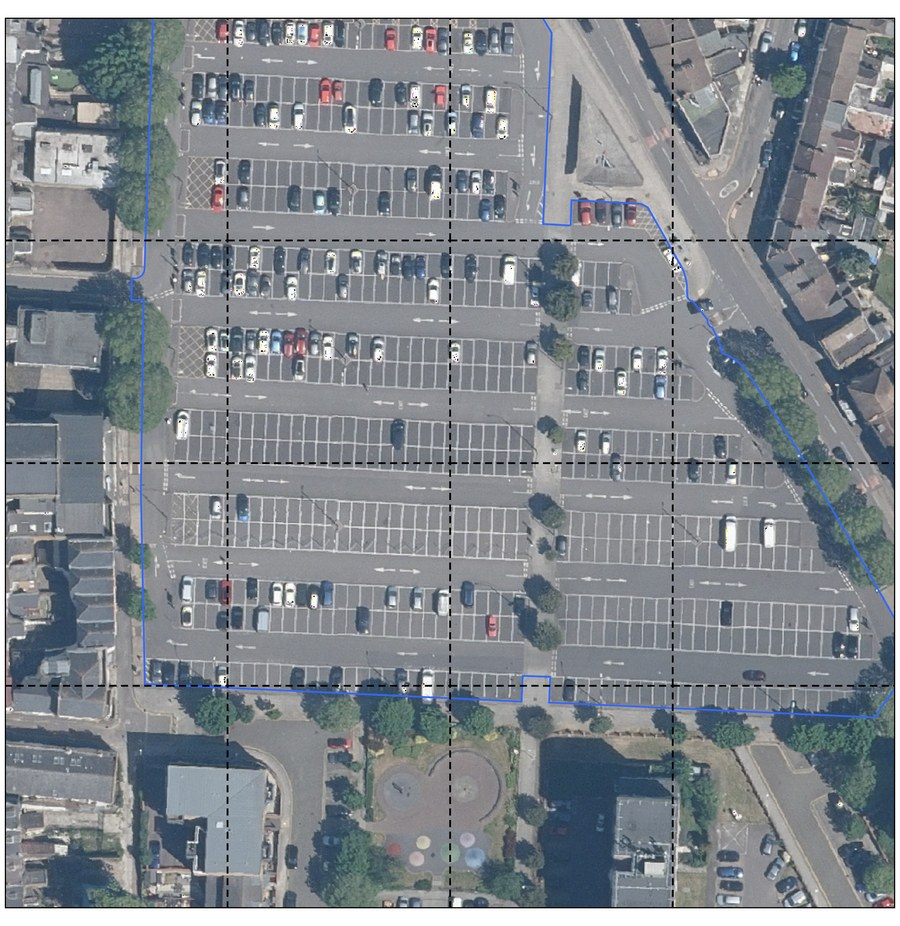
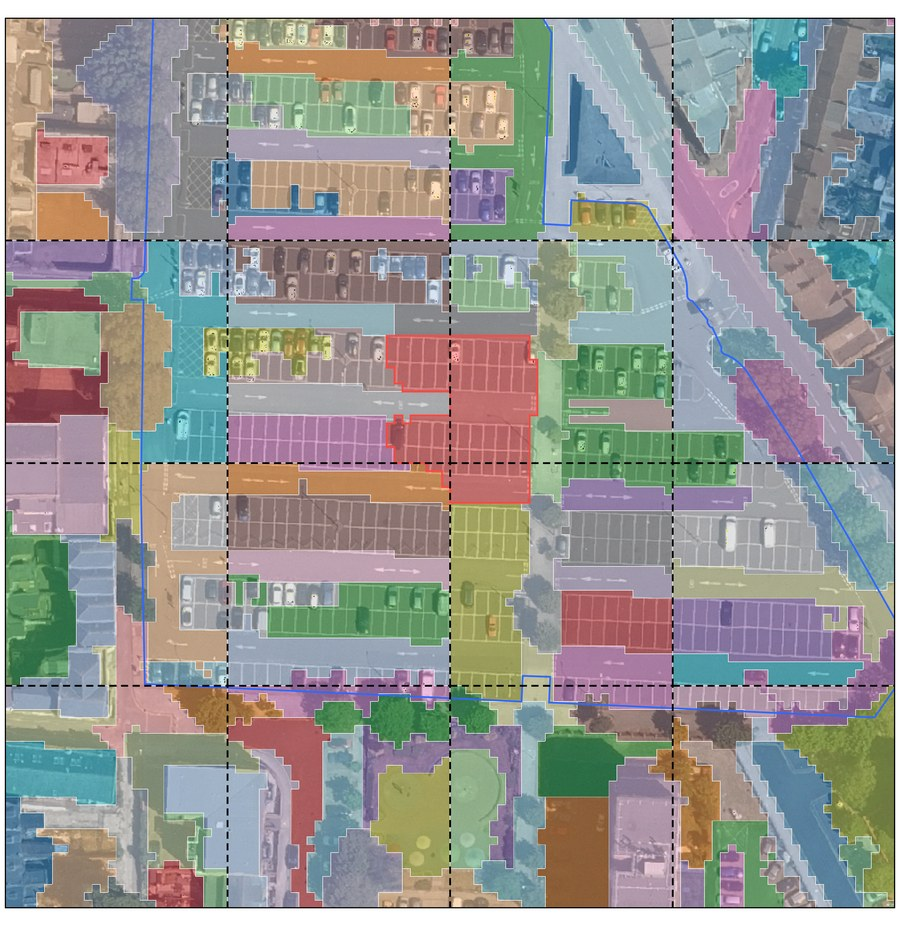
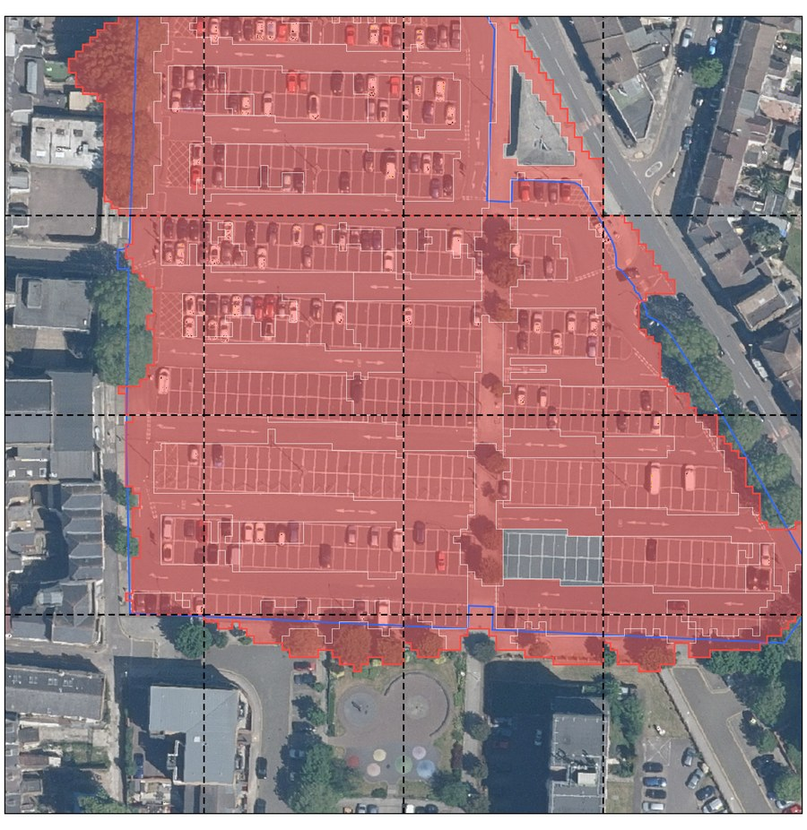
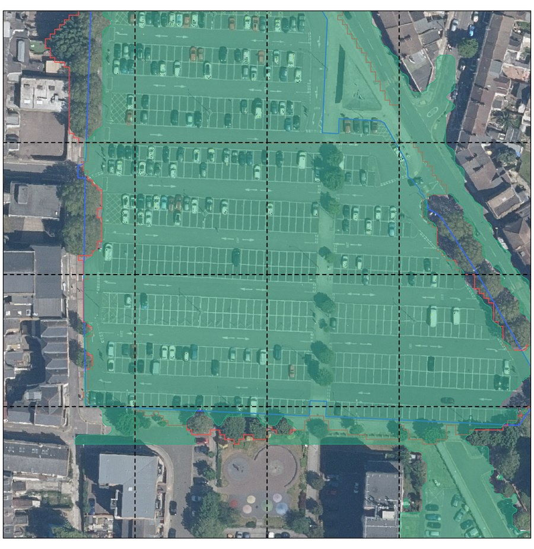

# unboxed

Stitches DINOv3 patch clusters across tile boundaries into seamless regions, so objects in large aerial imagery stay whole for text- and example-based search and segmentation.

Large orthophotos are usually indexed as a grid of fixed tiles, one embedding per tile. Objects get cut by the grid and diluted by whatever else shares their tile. `unboxed` indexes **regions** instead: coherent areas built from DINOv3 patch clusters that are merged across tile boundaries, each small enough to segment in one crop. A naive tile index is included as a baseline.

## How it works

**Ingest (per 448 px tile, native resolution)**
1. DINOv3 ViT-L/16 features for every 16 px patch (28 × 28 per tile), L2-normalised and positionally debiased (INSID3).
2. Agglomerative clustering of the patches (cosine, τ = 0.6); mostly-nodata patches are excluded.
3. Each cluster is split into spatially connected **pieces**, each embedded as the mean of its patches.

**Partition (across tiles)**

4. Pieces are merged across tile boundaries into **regions** by greedy Ward agglomeration on the piece adjacency graph, minimising `within-region variance + region_cost × #regions`, with every region at most 448 px across. A boundary-refinement pass then moves single pieces between neighbouring regions when that lowers the objective.

**Index**

5. One row per region: its polygon, a DINOv3 vector (size-weighted mean of its pieces) and, optionally, a SkyCLIP vector (a context crop of at least 224 px around the region). Both vectors live in the same table.

**Query**

6. Text queries search the SkyCLIP vectors; example queries (reference polygons) search the DINOv3 vectors. Retrieval always ranks the atomic regions.
7. **Query merge** (segmentation step): each hit that scores in the top 5% of the index for the query grows into its connected neighbours that also score in the top 5%. Regions need only be similar *for this query*, not similar overall: tarmac and car regions don't resemble each other, but both score well for "car park", so the car park is segmented as one area.
8. The INSID3 in-context head segments grouped native-resolution crops (448 / 672 / 896 px). Downsampling is limited per query so reference-sized objects keep at least 8 DINOv3 patches. For text queries, the top results serve as the head's reference shots.

### The pipeline

Two buildings (blue outlines) on either side of an ingestion tile boundary, searched for with 5 labelled example buildings. Dashed black lines are the 448 px tiles.

| | |
|---|---|
|  |  |
| **1. Imagery.** A 2 × 2 block of 448 px ingestion tiles. | **2. DINOv3 patches.** Each tile reaches DINOv3 at native resolution; every 16 px patch (28 × 28 per tile) gets its own feature vector. Colours only distinguish neighbouring patches. |
|  |  |
| **3. Per-tile clusters.** Similar-looking patches are clustered within each tile; nothing crosses a tile boundary yet. | **4. Pieces.** Each cluster is split into spatially connected pieces, each embedded from its own patches, so a building is no longer averaged with look-alikes elsewhere in the tile. |
|  |  |
| **5. Regions.** Pieces are merged across tile boundaries into regions of at most 448 px. The region holding the buildings (red) spans two tiles and is indexed as one row. | **6. Retrieval and segmentation.** The region ranks #16 of about 9,600. The head segments the crop around it (dashed red) and returns a separate mask for each building (green), with IoU 0.73 and 0.85. |

### Query merge

A large car park (blue outline) queried with the text prompt "car park". Dashed black lines are the 448 px ingestion tiles.

| | |
|---|---|
|  |  |
| **1. Imagery.** The tile grid cuts the car park into 12 parts. | **2. Regions.** The index splits it into many regions, because parked cars, bays and tarmac look different. The region holding the most of it (red) covers only 5%. |
|  |  |
| **3. Query merge.** Neighbouring regions that also score in the top 5% for "car park" are joined: 69 regions (white outlines) form one area (red) holding 94% of the car park. | **4. Segmentation.** The merged area is segmented as one object (green). Best IoU with the car park: 0.69, against 0.31 without merging. |

## Install

Requires Python 3.12 and [uv](https://docs.astral.sh/uv/); a CUDA GPU is strongly recommended.

```bash
uv sync            # or: uv sync --extra dev   (pytest, ruff)
```

### Model weights (not included)

| Model | Used for | Argument |
|---|---|---|
| DINOv3 ViT-L/16 (`dinov3_vitl16`, LVD-1689M pretrain) | clustering, embeddings, segmentation | `--dino-weights` |
| SkyCLIP ViT-L/14 (OpenCLIP checkpoint) | text search | `--skyclip-weights` |

DINOv3 is loaded through `torch.hub` (`facebookresearch/dinov3`); the hub repository is fetched once and then used from the local cache.

## Inputs

- **Imagery:** an 8-bit RGB(A) Cloud Optimised GeoTIFF in a **projected CRS with metre units**, with square pixels, at least 448 × 448 px. Nodata is taken from the dataset mask; tiles more than 75% nodata are skipped. Validation is strict by default (`--no-cog-check` relaxes the COG layout check).
- **Perimeter (optional):** GeoJSON polygon(s) in EPSG:4326. Only tiles intersecting it are processed.
- **Labels (evaluation only):** GeoJSON polygons in EPSG:4326 with a class name in a feature property (`label` by default, see `--label-property`).
- **References (example queries):** GeoJSON polygons in EPSG:4326.

All outputs (GeoJSON) are in EPSG:4326. Inside the tables, geometries are stored in the raster CRS, and each table records its CRS and pixel size in its schema metadata.

## Usage

```bash
IMAGE=ortho.tif
DINO=dinov3_vitl16_pretrain_lvd1689m.pth
SKYCLIP=skyclip_vit_l14.pt

# 1. Per-tile clustering -> pieces
uv run unboxed-ingest --image $IMAGE --perimeter area.geojson --dino-weights $DINO --table pieces

# 2. Cross-tile partition -> regions (optionally also as GeoJSON)
uv run unboxed-partition --pieces-table pieces --table regions --geojson regions.geojson

# 3. (Optional) Naive tile index, as a baseline
uv run unboxed-naive-index --image $IMAGE --perimeter area.geojson --dino-weights $DINO --table tiles

# 4. Add SkyCLIP vectors for text search (to either table)
uv run unboxed-skyclip --image $IMAGE --skyclip-weights $SKYCLIP --table regions

# 5. Query and segment
uv run unboxed-query --image $IMAGE --table regions --dino-weights $DINO \
    --skyclip-weights $SKYCLIP --text "car park" --output-dir out/car_park
uv run unboxed-query --image $IMAGE --table regions --dino-weights $DINO \
    --references examples.geojson --label "swimming pool" --output-dir out/pools
```

`unboxed-query` writes `results.geojson` (ranked hits with scores), `areas.geojson` (what was segmented, after query merge), `crops.geojson`, `masks.geojson` and `summary.json`. Use `--no-query-merge` to segment hits as retrieved.

All commands take `--db` (LanceDB directory, default `./lancedb`) and `--help`.

### Evaluation (with labelled polygons)

```bash
# Example-based search: references drawn from the labels, the rest held out
uv run unboxed-eval --image $IMAGE --labels labels.geojson --perimeter area.geojson \
    --label "swimming pool" --num-references 3 --reference-seed 0 \
    --table regions --dino-weights $DINO --output-dir eval/pools_seed0

# Text search for several classes (7 prompts each); labelled references for the head
uv run unboxed-eval-text --image $IMAGE --labels labels.geojson --perimeter area.geojson \
    --classes "swimming pool" "car park" --reference-seeds 0 1 2 --num-references 3 5 \
    --table regions --dino-weights $DINO --skyclip-weights $SKYCLIP --output-dir eval/text

# How well regions line up with labelled objects (no model needed)
uv run unboxed-partition-quality regions tiles --labels labels.geojson --perimeter area.geojson
```

`unboxed-eval --list-labels --labels labels.geojson` prints the classes and counts.

**Metrics**
- **Object AP / recall@k** (retrieval, independent of the head): each ranked result is judged by the crop the head would see for it, and an object counts as found at the first rank whose crop contains at least 50% of it. AP sums precision@r × the increase in recall at rank r.
- **Instance F1** at IoU ≥ 0.5 (one-to-one matching of masks and objects) and **mean best IoU** per object (unsegmented objects count as 0).
- **Partition quality:** completeness (largest share of an object inside one region), achievable IoU, and undersegmentation error.

## Tables

Region and tile tables share one schema:

| Column | |
|---|---|
| `region_id` | row id |
| `dino_vector` | 1024-d DINOv3 embedding |
| `skyclip_vector` | 768-d SkyCLIP embedding (after `unboxed-skyclip`) |
| `x_min, y_min, x_max, y_max` | bounds (raster CRS) |
| `area` | polygon area (CRS units²) |
| `num_members`, `member_ids` | pieces in the region (empty for tiles) |
| `mask_geojson` | polygon (raster CRS) |

Search is brute force (exact). For very large tables, add an ANN index on either vector column with LanceDB's `create_index`.

## Design notes

Choices kept after evaluation:
- **Native resolution:** tiles reach DINOv3 at full resolution (no downsampling before 448 px).
- **Pieces, not clusters:** splitting clusters into connected pieces keeps scattered look-alikes from sharing one embedding.
- **Region cost 12.25, cap 448 px:** larger caps (896 px, or growth only for very uniform areas) did not keep large objects whole: their pieces split because they look different, not because of the cap.
- **Per-tile clustering first:** partitioning raw patches across tiles (skipping per-tile clustering) helped some large objects but merged small distinctive ones (e.g. pools) into their surroundings.
- **SkyCLIP context crops:** masking out everything outside the region, or cropping tightly to it, were worse overall.
- **Query merge only at segmentation time:** merging inside the ranking, or using merged areas as reference shots, hurt small objects.

**Reproducibility:** DINOv3 outputs vary slightly with GPU batch size, enough to move some cluster boundaries near the clustering threshold. Results are reproducible for a fixed `--batch-size`, but not across different ones.

## Licence

Copyright 2026 Sensat Ltd. Licensed under the [Apache License 2.0](LICENSE); see also [NOTICE](NOTICE).

`src/unboxed/insid3/models` and `src/unboxed/insid3/utils` are adapted from the INSID3 reference implementation, also under the Apache License 2.0. Modified files are marked at the top, and the changes are listed in `src/unboxed/insid3/NOTICE`.

Model weights are not part of this repository and come with their own terms: DINOv3 weights are released by Meta under the DINOv3 License, and SkyCLIP weights under their authors' terms. Obtain and accept them separately.

## Tests

```bash
uv run --extra dev pytest
```

The tests need no weights or imagery.
